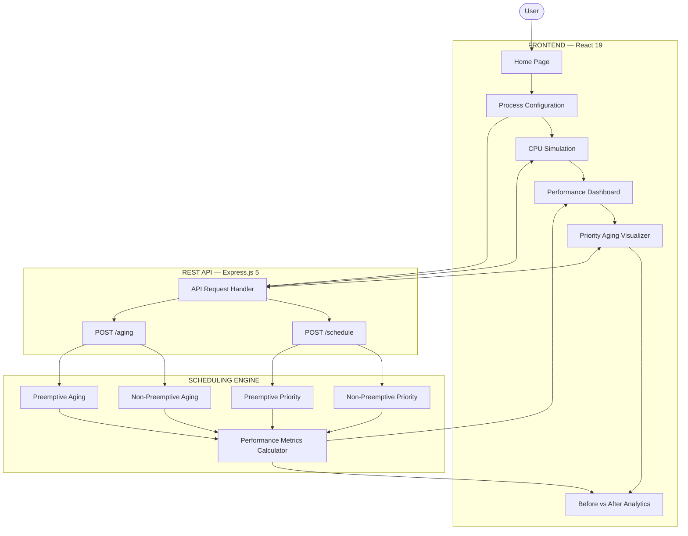
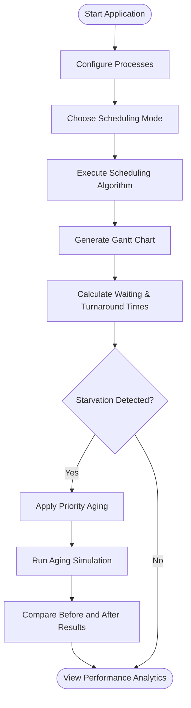

# ⚡ Priority Scheduler 3D

### Adaptive CPU Scheduling Engine & Starvation Mitigation Visualizer

\<p align="center">
&#x20; \<strong>Visualize. Simulate. Optimize. Understand.\</strong>
\</p>

\<p align="center">
&#x20; An interactive full-stack Operating System scheduling platform that brings CPU Priority Scheduling algorithms to life through real-time simulation, dynamic priority aging, starvation detection, and comparative performance analytics.
\</p>

\<p align="center">
&#x20; \<a href="[https://priority-scheduler-hzsu.onrender.com/](https://priority-scheduler-hzsu.onrender.com/)">
&#x20;   \<strong>🚀 Live Demo\</strong>
&#x20; \</a>
&#x20; &nbsp; • &nbsp;
&#x20; \<strong>📖 Documentation\</strong>
&#x20; &nbsp; • &nbsp;
&#x20; \<strong>💻 Source Code\</strong>
\</p>

---

## 🧠 About the Project

**Priority Scheduler 3D** is an interactive CPU scheduling simulation and analysis platform designed to demonstrate how operating systems allocate CPU resources using priority-based scheduling algorithms.

Traditional priority scheduling can cause **process starvation**, where low-priority processes wait indefinitely while higher-priority processes continuously receive CPU time.

This project addresses that problem through dynamic Priority Aging algorithms, allowing waiting processes to gradually improve their effective priority.

The platform combines a Node.js computational engine with a React-based interactive visualization interface to simulate execution, track process states, identify starvation, and compare scheduling performance before and after applying aging.

### 🎯 Core Objectives

- Simulate Preemptive and Non-Preemptive Priority Scheduling.
- Demonstrate process execution through interactive Gantt charts.
- Detect potential process starvation during execution.
- Implement dynamic Priority Aging to improve scheduling fairness.
- Calculate and compare Average Waiting Time and Average Turnaround Time.
- Make complex Operating System concepts easier to understand through visualization.

---

## 🌐 Live Application

\<p align="center">
&#x20; \<a href="[https://priority-scheduler-hzsu.onrender.com/](https://priority-scheduler-hzsu.onrender.com/)">
&#x20;   \
&#x20; \</a>
\</p>

**Try the application:**
[https://priority-scheduler-hzsu.onrender.com/](https://priority-scheduler-hzsu.onrender.com/)

---

## ✨ Key Features

### 1. Intelligent Process Configuration

- Dynamically add and configure processes.
- Define Arrival Time, Burst Time, and Priority.
- Reorder processes using drag-and-drop interactions.
- Visualize process distributions before execution.
- Select Preemptive or Non-Preemptive scheduling modes.

### 2. CPU Scheduling Simulation

- Execute priority scheduling algorithms.
- Simulate process execution step by step.
- Visualize transitions between Ready Queue, CPU, and Completed states.
- Control simulation playback speed from 0.5x to 3.0x.
- Generate dynamic Gantt charts.

### 3. Starvation Detection

- Monitor processes waiting in the ready queue.
- Identify processes waiting for 10 or more simulation time units.
- Display visual starvation alerts.
- Observe how scheduling decisions affect process waiting times.

### 4. Dynamic Priority Aging

- Apply aging to waiting processes.
- Support both Preemptive and Non-Preemptive aging algorithms.
- Display changing effective priorities.
- Visualize priority promotions during execution.
- Demonstrate how aging reduces starvation.

### 5. Performance Analytics

- Calculate Average Waiting Time (AWT).
- Calculate Average Turnaround Time (ATAT).
- Display process completion times.
- Compare scheduling performance before and after aging.
- Visualize performance metrics through interactive charts.

---

## 🏗️ System Architecture

The application follows a **decoupled client-server architecture**, separating the scheduling computation engine from the visualization layer.

### High-Level Architecture



### Application Workflow



---

## ⚙️ Technology Stack

| Category           | Technologies                                     |
| ------------------ | ------------------------------------------------ |
| Frontend           | React 19, JavaScript, HTML5, CSS3                |
| Routing            | React Router                                     |
| Backend            | Node.js, Express.js 5                            |
| API Communication  | REST APIs, Fetch API                             |
| Drag and Drop      | @hello-pangea/dnd                                |
| Data Visualization | Recharts, Chart.js                               |
| State Management   | React Hooks                                      |
| Storage            | Browser LocalStorage                             |
| Development Tools  | VS Code, npm                                     |
| Version Control    | Git, GitHub                                      |
| Deployment         | Render, Vercel-compatible frontend configuration |

---

## 🧮 Core Scheduling Algorithms

The backend implements four scheduling algorithms.

### 1. Non-Preemptive Priority Scheduling

In this algorithm, the CPU selects the highest-priority process from the ready queue and executes it until completion.

**Working principle:**

1. Identify all processes that have arrived.
2. Select the process with the highest priority.
3. Execute the selected process completely.
4. Calculate completion, waiting, and turnaround times.
5. Repeat until all processes finish.

### 2. Preemptive Priority Scheduling

In preemptive scheduling, the CPU reevaluates the ready queue at each time unit.

If a higher-priority process becomes available, the currently executing process can be interrupted.

**Working principle:**

1. Advance the simulation in discrete time units.
2. Identify eligible processes.
3. Select the highest-priority process.
4. Execute it for one time unit.
5. Update remaining execution time.
6. Reevaluate the ready queue.

### 3. Non-Preemptive Priority Aging

This algorithm dynamically improves the priority of waiting processes to reduce starvation.

**Priority Aging Formula:**

```text
Effective Priority = max(1, Original Priority - Waiting Time)
```

As waiting time increases, the numerical priority value decreases, improving the process's scheduling position.

### 4. Preemptive Priority Aging

This algorithm combines preemptive scheduling with proportional priority aging.

**Priority Aging Formula:**

```text
Executed Time = Burst Time - Remaining Time

Waiting Time = Current Time - Arrival Time - Executed Time

Effective Priority =
max(1, Original Priority - floor(Waiting Time / Original Priority))
```

When effective priorities are equal, earlier arrival time is used as a tie-breaking criterion.

**Priority convention:** Lower numerical values represent higher priority.

---

## 📊 Performance Metrics

The platform calculates important CPU scheduling metrics.

| Metric                  | Formula              | Description                              |
| ----------------------- | -------------------- | ---------------------------------------- |
| Completion Time (CT)    | Final execution time | Time when a process finishes             |
| Turnaround Time (TAT)   | CT − AT              | Total time spent in the system           |
| Waiting Time (WT)       | TAT − BT             | Time spent waiting for CPU execution     |
| Average Waiting Time    | ΣWT / N              | Average waiting time of all processes    |
| Average Turnaround Time | ΣTAT / N             | Average turnaround time of all processes |

Where:

- AT = Arrival Time
- BT = Burst Time
- N = Total number of processes

### Before vs After Priority Aging

The application provides a comparative analytics interface to evaluate:

- Changes in average waiting time.
- Changes in average turnaround time.
- Individual process performance.
- Scheduling fairness and starvation mitigation.

---

## 🔌 REST API Documentation

The backend exposes two primary REST endpoints.

### 1. Standard Scheduling

**Endpoint:** `POST /schedule`

**Request:**

```json
{
  "type": "preemptive",
  "processes": [
    {
      "id": "P1",
      "arrival": 0,
      "burst": 5,
      "priority": 2
    },
    {
      "id": "P2",
      "arrival": 1,
      "burst": 3,
      "priority": 1
    }
  ]
}
```

**Purpose:**
Executes the selected standard priority scheduling algorithm and returns process metrics and Gantt chart data.

### 2. Scheduling with Priority Aging

**Endpoint:** `POST /aging`

**Request:**

```json
{
  "type": "preemptive",
  "processes": [
    {
      "id": "P1",
      "arrival": 0,
      "burst": 5,
      "priority": 2
    },
    {
      "id": "P2",
      "arrival": 1,
      "burst": 3,
      "priority": 1
    }
  ]
}
```

**Purpose:**
Executes the selected aging-based scheduling algorithm and returns updated scheduling metrics and effective priorities.

---

## 📁 Project Structure

```text
priority-scheduler-3d/
│
├── backend/
│   ├── server.js
│   ├── package.json
│   └── package-lock.json
│
├── frontend/
│   ├── public/
│   │   └── index.html
│   │
│   ├── src/
│   │   ├── pages/
│   │   │   ├── Home.js
│   │   │   ├── Input.js
│   │   │   ├── Simulation.js
│   │   │   ├── Results1.js
│   │   │   ├── Aging.js
│   │   │   ├── Results2.js
│   │   │   └── Dashboard.js
│   │   │
│   │   ├── App.js
│   │   ├── App.css
│   │   ├── index.js
│   │   └── index.css
│   │
│   ├── package.json
│   └── package-lock.json
│
├── process.txt
└── .gitignore
```

---

## 💻 Getting Started

Follow these instructions to run the project locally.

### Prerequisites

Make sure you have installed:

- Node.js
- npm
- Git
- Visual Studio Code (recommended)

### Step 1: Clone the Repository

```bash
git clone YOUR_GITHUB_REPOSITORY_URL
```

```bash
cd priority-scheduler-3d
```

### Step 2: Configure the Backend

```bash
cd backend
npm install
npm start
```

The backend uses the port configured through `process.env.PORT` or its local default.

### Step 3: Configure the Frontend

Open a new terminal:

```bash
cd frontend
npm install
```

Configure the backend API URL through the frontend environment variable:

```env
REACT_APP_API_URL=http://localhost:5000
```

Ensure the URL matches the actual backend address and port.

Start the frontend:

```bash
npm start
```

### Step 4: Open the Application

```text
http://localhost:3000
```

You can now configure processes and explore the scheduling simulations.

---

## 🧪 Engineering Challenges & Technical Decisions

Some of the important engineering challenges addressed during development include:

**1. Process Starvation**

Traditional priority scheduling can indefinitely delay low-priority processes. Dynamic priority aging was implemented to improve scheduling fairness.

**2. Preemptive Execution Tracking**

The backend uses discrete time-unit simulation to track remaining execution time and accurately represent preemption boundaries.

**3. Gantt Chart Generation**

Continuous execution slices are merged into appropriate Gantt blocks, making the resulting execution timeline easier to understand.

**4. Real-Time Visualization**

React state and hooks synchronize process transitions, timers, simulation speed, and visualization updates.

**5. Performance Comparison**

The application calculates scheduling metrics before and after aging, allowing users to examine the impact of starvation mitigation.

---

## 🔬 Current Limitations

The following are known areas for improvement:

- Automated unit and integration tests for scheduling algorithms are not yet implemented.
- Backend request validation and numerical boundary checks need improvement.
- Persistent database storage and user authentication are not implemented.
- The current AI recommendation panel uses predefined heuristic rules rather than a trained AI model.
- Dedicated event-driven scheduling and priority queue optimization are potential performance improvements.
- Actual WebGL-based 3D rendering is not implemented; current visual effects use CSS.

Documenting these limitations helps distinguish implemented functionality from future development.

---

## 🚀 Future Enhancements

The project can be extended with:

- Binary Min-Heap-based priority queues.
- Event-driven scheduling simulation.
- Automated algorithm testing and benchmarking.
- Advanced scheduling algorithms such as Round Robin and Shortest Job First.
- Configurable aging parameters.
- More advanced scheduling fairness measurements.
- Machine-learning-based scheduling policy experiments.
- Python-based simulation and AI-driven optimization.
- Persistent scheduling history and analytics.

---

## 🎓 Concepts Demonstrated

This project demonstrates practical implementation of several Computer Science concepts:

- Operating Systems and CPU Scheduling.
- Preemptive and Non-Preemptive Execution.
- Process Management and Starvation.
- Priority Aging and Scheduling Fairness.
- Data Structures and Algorithms.
- Discrete-Event Simulation.
- RESTful API Development.
- Full-Stack Software Engineering.
- React Component Architecture.
- Data Visualization and Performance Analytics.

---

## 👨‍💻 Author

**Hiba Tharunnum Shaik**

Aspiring Software Developer | AI & Cybersecurity Enthusiast | Python | Full Stack Development

📧 Email: [shaikhibatharunnum@gmail.com](mailto\:shaikhibatharunnum@gmail.com)

💼 LinkedIn: [Connect on LinkedIn](https://linkedin.com/in/hiba-tharunnum-shaik-60a33b393)

🌐 Live Project: [Priority Scheduler 3D](https://priority-scheduler-hzsu.onrender.com/)

---

## ⭐ Support

If you find this project useful for understanding CPU scheduling, Operating Systems, or algorithm visualization, consider giving the repository a star!

\<p align="center">   \<strong>Built with curiosity, algorithms, and a passion for software engineering. ⚡\</strong> \</p>
